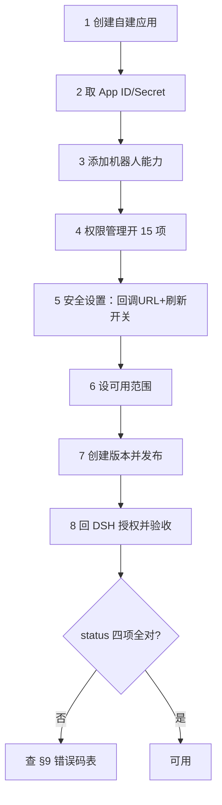

# 飞书管理后台配置全流程（给 dsh-feishu 用）

> **这份文档是飞书开放平台后台配置的唯一权威说明。**
> 读者：要在自己企业里把这个插件跑起来的人（应用创建者或企业管理员）。
> 配套：[`install-for-others.md`](./install-for-others.md)（装到机器上）、[`user-guide.md`](./user-guide.md)（装好怎么用）、[`feishu-capabilities.md`](./feishu-capabilities.md)（能力↔权限对照）。
> 实测环境：飞书开放平台（`open.feishu.cn`）· 自建应用 · 2026-10

---

## 0. 全景：八步，顺序不能乱



三条铁律先记住，后面每一步都在为它们服务：

| # | 铁律 | 违反的后果 |
|---|---|---|
| 1 | **勾了权限必须「创建版本并发布」** | 权限不生效，调用报 `99991679` |
| 2 | **后台改动后用户必须重新授权一次** | 用户授权范围在点「同意」那刻固化，不会自动扩 |
| 3 | **`offline_access` 决定能否自动续期** | 缺了约 2 小时就要人工重授权 |

---

## 1. 确认你有操作权限

| 你是谁 | 能做什么 | 限制 |
|---|---|---|
| 应用**创建者** | 建应用、改配置、勾权限、**发起**发版 | 发版需**企业管理员审批**才生效 |
| 企业**管理员** | 上述全部 + 直接审批通过 | —— |
| 普通成员 | 只能在「应用可用范围」内被授权使用 | 不能改配置 |

> 实测坑：勾完权限没生效，多数情况不是没保存，而是**版本还没发布/审批**。发版后在「权限管理」页应看到状态是**已生效**，而不是「待发布」。

---

## 2. 创建企业自建应用

1. 打开 <https://open.feishu.cn/app>（开发者后台）
2. 「创建企业自建应用」→ 填**应用名称**（如 `DSH 助手`）、描述、图标 → 创建
3. 创建后进入应用详情页，页面地址形如
   `https://open.feishu.cn/app/cli_xxxxxxxxxxxxxxxx/baseinfo`

> 注意选 **企业自建应用**，不是「商店应用」——后者要上架审核，本地自用没必要。

---

## 3. 取 App ID / App Secret

「开发配置 → 凭证与基础信息」：

| 值 | 形如 | 用途 | 注意 |
|---|---|---|---|
| **App ID** | `cli_aa6a2c729df89cc3` | 填进 DSH 配置 `appId` | 不是秘密，可出现在日志里 |
| **App Secret** | 32 位随机串 | 换 tenant/user token | **是秘密**，只放凭据库 |

App Secret 保管原则：

- 存 `~/.dsh/.credentials.yaml` 的 `refs.FEISHU_APP_SECRET`（0600），**不要**写进代码、聊天、shell 历史、supervisor conf（后者通常 644）
- 曾在聊天/日志里出现过 → 到「凭证与基础信息」点**重置**，然后更新本地那唯一一处；重置后旧 token 全部立即失效
- DSH 侧读取顺序：**凭据库 → 环境变量 `FEISHU_APP_SECRET` → config.appSecret**

---

## 4. 添加应用能力：机器人

「添加应用能力」→ 勾选 **机器人** → 保存。

- 作用：让应用能以**机器人身份**发消息（`feishu_message identity=app`）、能被拉进群、能接收群里的 @
- 不加以应用身份发消息会失败；以**用户身份**发消息不依赖它
- 若要用 `feishu_message` 的 `webhook` 动作，那还得在**群设置里另建自定义机器人**拿 webhook URL（与本应用无关，是两套东西）

---

## 5. 权限管理：开通这 15 项

「开发配置 → 权限管理」，逐个搜索开通。每项都有「用户身份 / 应用身份」两类，**建议两列都开**：

- 插件默认以**用户身份**为主（东西落在你本人云空间）→ 必须开「用户身份」
- 没有用户授权时回退**应用身份** → 开「应用身份」可兜底，且便于用 tenant token 自检

| # | 权限 | 中文名 | 用途 | 缺了会怎样（实测症状） |
|---|---|---|---|---|
| 1 | `offline_access` | 持续访问已授权的数据 | 拿 refresh token，实现自动续期 | `refreshable: false`；约 2 小时就要重授权；续期报 `20037/20064/20073` |
| 2 | `bitable:app` | 多维表格 | 建 Base/表/字段/记录 | 全部 bitable 动作 `99991679` |
| 3 | `base:table:read` | 获取数据表信息 | LiteQuery 聚合（求和/分组/Top-N） | `feishu_query` 全线 `99991679` |
| 4 | `base:dashboard:read` | 获取仪表盘信息 | 列/读仪表盘与图表数据 | 仪表盘读操作失败 |
| 5 | `base:dashboard:create` | 创建仪表盘 | 建仪表盘、加图表块 | 建仪表盘/块失败 |
| 6 | `base:dashboard:update` | 更新仪表盘 | 改块、改仪表盘 | 改块失败 |
| 7 | `base:dashboard:delete` | 删除仪表盘 | 删块、删仪表盘 | 删块失败 |
| 8 | `docx:document` | 新版文档 | 建/读/写文档、导入 | 全部 doc 动作失败 |
| 9 | `docx:document.block:convert` | 转换文本为云文档块 | `append_markdown`（Markdown→块） | `append_markdown` 报 `99991679` |
| 10 | `drive:drive` | 云空间 | 列/传/下载/移动/删除文件与文件夹 | 全部 drive 动作失败 |
| 11 | `sheets:spreadsheet` | 电子表格 | 建表/读写区域/加工作表 | 全部 sheet 动作失败 |
| 12 | `wiki:wiki` | 知识库 | 列空间/节点、解析节点 token | 全部 wiki 动作失败 |
| 13 | `im:message` | 发消息 | 文本/卡片/富文本/回复 | 发消息失败 |
| 14 | `im:resource` | 传图片/文件 | `send_image` / `send_file` | 传图传文件失败 |
| 15 | `contact:user.base:readonly` | 读用户基础信息 | 拿授权人姓名/open_id 显示在 status | `feishu_auth status` 里用户信息不全 |

两个高频踩点：

1. **仪表盘是四个独立权限**（read / create / update / delete）。只开 read，创建/改/删照样 `99991679`——这是本轮实际踩过的。
2. 报错里会写清缺哪个：`detail` 字段中的
   `required one of these privileges under the user identity: [base:dashboard:create]`
   —— **照抄那个名字去开**，比自己猜准。

---

## 6. 安全设置

### 6.1 重定向 URL（OAuth 回调）

「开发配置 → 安全设置 → 重定向 URL」，加**两条**（`127.0.0.1` 与 `localhost` 都加，规避系统代理差异）：

```text
http://127.0.0.1:3080/api/feishu/oauth/callback
http://localhost:3080/api/feishu/oauth/callback
```

端口 `3080` 换成你自己的 `dsh web` 端口。规则（查证官方文档）：

| 规则 | 说明 |
|---|---|
| 协议 | `http` 也可以，官方示例本身就是 `http://example.com:8080/…` |
| 必须逐字匹配 | 协议、端口、完整路径一个字符都不能差；不匹配会跳到失败页并报 `{code:2000, message:"redirect_uri unmatch"}` |
| 必须含完整路径 | 只填域名不行 |
| `?` / `#` 后缀不生效 | 不要带 query |
| 单应用上限 | 300 条 |
| 不支持动态路由 | 不能写 `*` |
| 不支持通配 | —— |

> 本机若开着系统代理、且代理绕过表写的是 `127.*`，浏览器访问 `127.0.0.1` 会被代理吃掉（Chrome 不认这种通配）→ 这种情况下用 `localhost` 那条，并在 DSH 配置里显式设 `oauthRedirectUri`。

### 6.2 开启「刷新 user_access_token」

「安全设置」里找 **刷新 user_access_token** 的开关，**保持开启**（多数租户默认开）。

- 关闭时续期接口直接报 `20074 The specified app is not allowed to refresh token`
- 改完必须**发版**才生效
- 看不到这个开关通常说明你租户不需要它（默认已开）

### 6.3 其他安全项

| 项 | 建议 |
|---|---|
| IP 白名单 | **留空**（本机/内网动态 IP 填了会把自己挡在门外） |
| 仅允许管理员使用 / 限定可用范围过窄 | 注意：**授权用户必须在可用范围内**，否则授权页报 `20010` |
| 网页应用 / H5 相关配置 | 与本插件无关，可不填 |

---

## 7. 设置可用范围（谁可以授权）

「版本管理与发布 → 创建/编辑版本」里的**可用范围**（部分界面在「应用信息 → 可用范围」）。

- 至少要包含**你要授权的那个用户**（通常是自己，或整个部门/全员）
- 范围外的人点授权链接会失败：`20010 The user does not have permission to use this app`
- 改了可用范围同样要**发版**

---

## 8. 创建版本并发布 ⚠️ 最容易漏

「版本管理与发布 → 创建版本」：

1. 填**版本号**（如 `1.0.0`）、**更新说明**（写清「新增 dsh-feishu 所需权限」）
2. 确认**可用范围**
3. 「申请发布」→ 企业管理员审批（你是管理员则直接通过）
4. 发版后回「权限管理」，逐项确认状态是 **已生效**，不是「待发布」

> **只勾权限不发版 = 什么都没发生。** 这条是本项目踩过两次的坑。
> 判断是否真生效：在 DSH 里跑 `feishu_auth status`，看 `user.scope` 里是否出现了新权限名。

---

## 9. 回到 DSH：填配置 → 授权 → 验收

配置细节见 [`install-for-others.md`](./install-for-others.md) §3，最短路径：

```yaml
# ~/.dsh/profiles/web/cordis.patch.yml
- id: feishu
  config:
    appId: 'cli_你的AppID'
```

```yaml
# ~/.dsh/.credentials.yaml （0600）
version: 1
refs:
  FEISHU_APP_SECRET: '你的AppSecret'
```

重启 dsh-web，然后在对话里：

```text
feishu_auth action=authorize_url   → 点开链接，同意授权（页面应显示「已连接 / Authorized as 你」）
feishu_auth action=status          → 逐项核对下表
```

### 验收判据（四项全对才算通）

| 字段 | 期望 | 不对时看哪里 |
|---|---|---|
| `tenantTokenOk` | `true` | App ID/Secret 或 §8 发版 |
| `user.authorized` | `true` | 授权没完成/回调失败（§11） |
| `user.refreshable` | **`true`** | §5 第 1 项 `offline_access` 是否开了并已发版 |
| `user.scope` | 含 `offline_access` 且条数 ≈ 15–16 | §5 权限是否开了、是否发版、是否**重新授权** |
| `warnings` | **空** | 按告警文字处理 |

再加两条真调用：

```text
feishu_auth action=refresh          → 连跑两次都应成功，refreshable 始终 true
feishu_drive action=list_files pageSize=5 identity=user   → 能列出你云空间的文件
```

---

## 10. 以后要加权限，怎么改（变更流程）

顺序固定，跳步必翻车：

```text
① 后台勾新权限 → ② 创建版本并发布 → ③ 用户重新授权一次 → ④ feishu_auth status 看 scope 是否扩了
```

**为什么必须第 ③ 步**：用户授权范围（user scope）在你点「同意」那一刻**固化**进 grant，事后后台再开权限也不会自动扩。所以「后台已开、调用还报 99991679」的典型原因就是**没重新授权**。

快捷判别（不用猜）：

- 拿**应用身份**（tenant token）调同一接口**成功**，但**用户身份**失败 ⇒ 就是用户 grant 还是旧的
- 反过来说明应用权限本身没生效 ⇒ 回第 ② 步查发版

---

## 11. 回调失败时的三种情况

| 页面现象 | 原因 | 处理 |
|---|---|---|
| `state mismatch` | 插件 < 0.1.1 时工具生成的链接没登记 state | 升级到 0.1.1；或改用 DSH 设置页的授权入口 |
| `ERR_TOO_MANY_REDIRECTS` | 本地鉴权插件（如 `dsh-web-startup-auth`）cookie 用了 `SameSite=Strict`，跨站跳回不回传 | 改成 `Lax`（补丁在 `node_modules`，插件更新会覆盖） |
| 打不开/超时/502 | 系统代理吃掉了 `127.0.0.1` | 换 `localhost` 那条重定向，或在代理里放行 |

**通用兜底**（不依赖回跳）：报错页地址栏里仍带 `code=xxx`（回调在兑换前就失败了，code 未被消费），复制它，用
`feishu_auth action=complete code=<code>` 直接兑换。

---

## 12. 错误码对照表（后台侧原因）

| 错误码 | 含义 | 后台该做什么 |
|---|---|---|
| `99991679` | 缺少用户/数据权限 | §5 开对应权限 → **发版** → **重新授权** |
| `99991672` | 缺少 API 权限 | §5 开权限并发版 |
| `2000`（redirect_uri unmatch） | 回调地址没逐字匹配 | §6.1 逐字加 |
| `20010` | 用户没有该应用的使用权限 | §7 把该用户加进可用范围并发版 |
| `20009` | 租户未安装/未启用应用 | §8 发布应用 |
| `20037` / `20064` / `20073` | refresh token 过期 / 已撤销 / 已用过（一次性） | 重新授权；检查 §5 第 1 项与 §6.2 开关 |
| `20074` | 应用未开启「刷新 user_access_token」 | §6.2 开启并发版 |
| `1254001` | 字段/表参数非法 | 与本插件无关，看 `detail` 原文（例：`formatter "0%"` 飞书不支持） |
| 365 天 | 用户授权满 365 天必须重新授权 | 到期前重授权一次；`refreshExpiresInDays` 即倒计时 |

---

## 13. 上线前检查清单

- [ ] 应用是**企业自建应用**，不是商店应用
- [ ] 记录下 App ID；App Secret 只落在凭据库（0600），没进代码/聊天/日志
- [ ] 「添加应用能力」已开**机器人**
- [ ] 15 项权限**两列**（用户身份 + 应用身份）都已开通
- [ ] 重定向 URL 加了 `127.0.0.1` 与 `localhost` 两条，端口与实际一致
- [ ] 「刷新 user_access_token」开关是开的
- [ ] 可用范围包含**将要授权的人**
- [ ] **已创建版本并发布**，权限管理页每项显示「已生效」
- [ ] DSH 侧 `feishu_auth status` 四项判据全对
- [ ] `feishu_auth action=refresh` 连跑两次都成功

---

## 附录 A：不用 DSH，也能自检应用权限是否生效

用 App ID/Secret 换 tenant token，再打一个只依赖「应用身份」接口：

```bash
APP_ID='cli_你的AppID'; APP_SECRET='你的AppSecret'

TOKEN=$(curl -s -X POST 'https://open.feishu.cn/open-apis/auth/v3/tenant_access_token/internal' \
  -H 'Content-Type: application/json' \
  -d "{\"app_id\":\"$APP_ID\",\"app_secret\":\"$APP_SECRET\"}" \
  | python3 -c 'import json,sys; print(json.load(sys.stdin).get("tenant_access_token",""))')

echo "tenant token 长度: ${#TOKEN}"     # 0 = App ID/Secret 不对
curl -s -H "Authorization: Bearer $TOKEN" \
  'https://open.feishu.cn/open-apis/drive/v1/files?page_size=1' | head -c 300
```

- 返回 `code: 0` 且有 `data` ⇒ 应用身份与 `drive:drive` 已生效
- 返回 `99991672/99991679` ⇒ 权限没开或**没发版**
- 本机若需代理出网，给 curl 加 `-x http://<你的代理>:<端口>`

> **用户身份**的权限无法用这个办法验（它取决于用户 grant），只能在 DSH 里看 `feishu_auth status` 的 `scope`。
